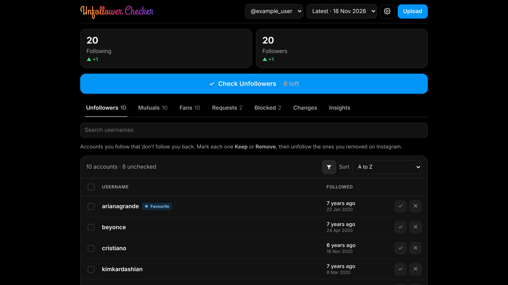

# Unfollower Checker

See who doesn't follow you back on Instagram, using the data export Instagram
gives you. No login, no third-party access to your account: the export is read
in your browser and never uploaded.

**[unfollower-checker-kitsudeve.vercel.app](https://unfollower-checker-kitsudeve.vercel.app)**



## Features

- **Unfollowers, Mutuals and Fans.** Accounts you follow that don't follow you
  back, accounts that follow each other, and accounts that follow you that you
  don't follow.
- **Keep or Remove.** Mark each unfollower and work through them in one go
  with Check Unfollowers. Filter by mark, follow date and labels.
- **Requests and Blocked.** Follow requests you sent that are still pending,
  and accounts you've blocked.
- **Changes between exports.** Upload a newer export and see who followed,
  unfollowed or changed their username since the last one.
- **Account details.** When you followed each account, when they followed you,
  and its history across exports.
- **Insights.** Charts of your following, followers and progress.
- **Backups.** Download a JSON backup and restore it on any device, or export
  a CSV that opens in Excel or Google Sheets.

## Getting your Instagram export

1. In Instagram, go to **Settings and activity → Accounts Centre → Your
   information and permissions → Export your information → Create export**.
2. Choose your profile, then **Export to device**.
3. Under **Customise information**, clear everything except **Followers and
   following**.
4. Set the date range to **All time** and the format to **JSON**.
5. When Instagram emails you that it's ready, download the zip and drop the
   whole file into the app.

The zip includes optional lists (close friends, favourites, pending requests,
blocked accounts and recently unfollowed). Uploading only `followers_1.json`
and `following.json` works, but those labels won't appear.

The export date is taken from the zip's name or the files inside it. An export
older than the latest one you've uploaded is refused, so the changes log stays
in order.

## Your data

- Nothing leaves your device. The only network requests are for the page
  itself, a font from Google Fonts and [JSZip](https://stuk.github.io/jszip/)
  from cdnjs to open the zip.
- Profiles and marks are saved in your browser's local storage. Clearing site
  data deletes them, so keep a backup (**Settings → Download backup**). Unless the
  browser has agreed to keep the data, the app reminds you when your last
  backup is more than 14 days old.
- Restoring a backup asks before changing anything and can be undone. Marks
  are merged account by account, keeping the most recent.

## Development

The whole app is one file, `index.html`, with inline CSS and JavaScript. There
is no build step and no runtime dependencies to install.

To run it locally, open `index.html` in a browser or serve the folder:

```sh
python3 -m http.server 8000
```

Every push to `main` is deployed to Vercel as a static site.

```
index.html      the app
docs/           images used in this README
tests/          browser tests (Playwright)
```

## Tests

The tests open the app in headless Chromium and use it the way a person would:
uploading exports, marking accounts, restoring backups. Every fixed bug has a
test that fails if it comes back. They need Node.js 18 or later.

```sh
cd tests
npm install
npx playwright install chromium
npm test
```

To run only some tests, pass part of a name: `node run.js "restore"`.

## Licence

No licence has been chosen yet, so all rights are reserved. Please ask before
reusing the code.

Unfollower Checker is not affiliated with Instagram or Meta.
